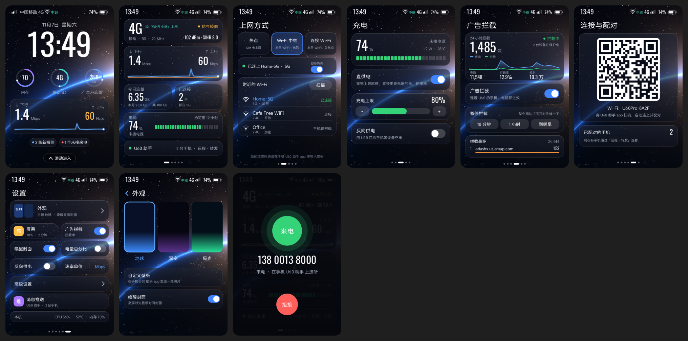

<div align="center">

# OpenU60

**Turn a ZTE U60 Pro (MU5250) pocket router into a bridge for a Chinese SIM card: the router takes the card's SMS, MMS and VoLTE calls and hands them to your phone.**

[简体中文](README.md) · English

</div>

OpenU60 keeps a Chinese SIM card in a ZTE U60 Pro. An agent runs on the router, on top of ZTE's stock firmware (no reflashing). It sends and receives the card's SMS, MMS and VoLTE calls, fixes the problems Chinese SIMs commonly have when roaming, and can put the router on your home Wi-Fi so you can switch off expensive roaming data. This repository holds everything that runs on or installs the router: the agent, a touchscreen program that can replace the stock screen UI, the macOS installer "U60 刷机助手" (U60 Toolkit), a relay and a push gateway you can host yourself for remote access, and a set of command-line scripts.

> **Read first**: this project is not affiliated with ZTE or any carrier. Enabling ADB, changing boot scripts and turning off firmware updates are risky: the router may stop at the boot logo, lose its warranty or lose data. Make a backup first, and follow your carrier's terms and local law.
>
> The detailed guides under `docs/openu60/` are written in Chinese. This README covers everything you need to install and use OpenU60; the guides add background and troubleshooting.

## Contents

- [What it does](#what-it-does)
- [Phone app](#phone-app)
- [Supported hardware and firmware](#supported-hardware-and-firmware)
- [Easiest: download the installer (Windows / Mac / Linux)](#easiest-download-the-installer-windows--mac--linux)
- [Install option 1: U60 Toolkit (recommended)](#install-option-1-u60-toolkit-recommended)
- [Install option 2: command-line scripts](#install-option-2-command-line-scripts)
- [Using it](#using-it)
- [Update, uninstall and recovery](#update-uninstall-and-recovery)
- [Building from source and tests](#building-from-source-and-tests)
- [Repository layout](#repository-layout)
- [Documentation](#documentation)
- [Acknowledgements](#acknowledgements), [License](#license), [Disclaimer](#disclaimer)

## What it does

**Router agent (`zte-agent/`)**

- **SMS**: send and receive, grouped into conversations. The STD (international) firmware encrypts SMS fields; the agent handles that for you. Optionally forward SMS to Telegram, ntfy, a webhook, Discord, Slack or another number (upstream feature).
- **MMS (experimental)**: catches MMS notifications, brings up the carrier's MMS APN and downloads pictures and audio; sending works too. Tested end to end on one non-Chinese carrier; the settings for the three Chinese carriers come from AOSP and are not verified end to end yet.
- **VoLTE calls**: incoming-call alerts, dialling, hang-up, DTMF; call audio is bridged both ways between the router's DSP and the phone (G.711, 8 kHz narrowband).
- **Chinese SIM roaming fixes**: turns IMS (VoLTE) registration back on when the carrier's configuration switches it off, keeps the "SMS over IMS" flag in step, and adds public DNS while the carrier's DNS does not answer.
- **Wi-Fi uplink**: in client mode the router joins your home Wi-Fi like a phone; in repeater mode one band joins the upstream network while the other keeps the hotspot. You can then turn off roaming data while SMS and calls still use the SIM. Comes back by itself after a reboot and retries when it gets stuck.
- **Data plan alerts**: monthly allowance, billing day, alert thresholds and a daily cap.
- **Notifications and router alerts**: pushes are set per device (incoming calls, missed calls, SMS, MMS); SMS can be limited to people in Contacts (verification codes still notify; the router only receives hashes of contact numbers). The router also warns about low battery, no service, VoLTE not registered, Wi-Fi uplink lost, overheating and charging finished; when the router has been offline for 5 minutes the push gateway sends that alert on its behalf.
- **Ad blocking**: network-wide, through the router's own DNS, with statistics.
- **Router management (upstream)**: signal and cells, band/cell locking, APNs, Wi-Fi (including a Wi-Fi 7 switch), firewall, DNS/DoH, USB, battery and charging, scheduled tasks, speed test, AT terminal, Mihomo, Tailscale and more, through an HTTP API and a web panel.

**Router touchscreen UI (`screen/`)**

A screen program of our own that you can switch to and from the stock UI: a lock screen with clock and live speeds, network status (signal, data usage, connected devices, battery, remote link), internet mode switching (SIM hotspot / Wi-Fi repeater / Wi-Fi client, picking a nearby network on screen), charging settings (charge limit, reverse charging), ad-blocking switch and statistics, a Wi-Fi QR code for connecting a phone, an incoming-call card, and settings for appearance, brightness and screen lock.



<sub>Rendered with sample data by the screen program's own preview tool `screen-preview`; identical to what the device shows (320×480, scaled 2×).</sub>

**U60 Toolkit (`desktop/U60Toolkit/`, macOS)**

A graphical installer with four steps in order: enable USB debugging → back up → install → pair a phone. It can also uninstall. Its interface is in Chinese; the labels are translated below.

**Remote access (`tunnel/`, `relay/`, self-hosted)**

When you are away from the router, the phone reaches it through an end-to-end encrypted QUIC tunnel: direct when NAT hole punching works, forwarded by a relay otherwise. The relay never sees the content. **This repository has no default server.** To use remote access, run your own relay (the smallest VPS is enough); see [Remote access and relay](docs/openu60/remote-access.md) (Chinese).

## Phone app

The companion iPhone app, **"U60 助手"**, is **not open source** and is coming soon to the App Store. A download link will be added here once it is available.

You do not need the app to use OpenU60:

- use the **router's own touchscreen** to switch internet modes and check status (see [Touchscreen UI](#touchscreen-ui));
- open the **web panel** in a browser to send and receive SMS, place calls and manage the router (see [Web panel](#web-panel));
- call the agent's **HTTP API** directly (see [install.md section 5](docs/openu60/install.md#5-从-mac-调用-agent-api)).

Push alerts for calls, answering on the lock screen and call audio on the phone need the phone app.

## Supported hardware and firmware

| Item | Notes |
|---|---|
| Router | ZTE U60 Pro (MU5250), hardware `MU5250_HW1.0` (Qualcomm SDX75, ZWRT/OpenWrt 23.05) |
| Tested firmware | International `STD_PL_MU5250V1.0.0B02` |
| Other firmware | Chinese B27/B31, Hong Kong and others are **not tested**. SMS encryption, Wi-Fi uplink and call audio are written for the STD firmware and may not work elsewhere; the community reports that B31 blocks enabling ADB from the web UI |
| Computer | Windows 10/11, Mac or Linux with the downloadable installer; building from source needs a Mac (tested on Apple Silicon) |
| Cable | A USB-C cable that carries data |
| SIM card | International roaming enabled; the local network must support VoLTE roaming for this card, especially in countries that have shut down 2G/3G |

## Easiest: download the installer (Windows / Mac / Linux)

No developer tools and no compiling. Open [Releases](https://github.com/Yakultt-t/openu60/releases), find the newest "安装程序 / Installer" release and download the file for your system: `OpenU60-Installer-Windows-x64-relay.exe` or `OpenU60-Installer-Windows-x64.exe` (see below), `OpenU60-Installer-macOS-arm64` or `OpenU60-Installer-Linux-x64`.

It is a single file that already contains the router programs. Double-click it (on Mac/Linux, run it in a terminal) and pick menu numbers: 1 enable USB debugging (router admin password), 2 back up the router configuration, 3 optional full eMMC backup (~7.6 GB, verified per chunk), 4 install / update (shows the **SIM Go password** once — keep it for pairing), 5 status, 6 uninstall. The menu is in Chinese; the same actions work as arguments: `enable-adb`, `status`, `backup [dir]`, `backup-full [dir]`, `install [--new-password]`, `uninstall`.

On Windows: the file is not code-signed, so SmartScreen may say "Windows protected your PC" (More info → Run anyway). If adb is missing the tool offers to download Google's platform-tools. Windows has no driver for the router's ADB interface out of the box: if ADB is not detected after step 1, the tool downloads Google's USB driver, opens Device Manager and walks you through picking "Android ADB Interface" for the device with the yellow mark (once per PC).

**Later updates need no computer:** once installed with installer v0.2.0 or newer, the router software updates from the phone app (Settings > Device > Router software). The router downloads the release from this repository, checks its signature and every file's checksum, and puts the previous version back by itself if the new one does not start. Routers installed with v0.1.0 need one more run of the new installer (keeps the password and data).

**Already running UFI-TOOLS on the router?** Import the [UFI plugin](desktop/ufi-plugin/) to install, update or remove it from the UFI-TOOLS web page, no computer needed.

On a Mac, clear the download quarantine first: `xattr -d com.apple.quarantine OpenU60-Installer-macOS-arm64 && chmod +x OpenU60-Installer-macOS-arm64`.

The two Windows files differ only in remote access. The `-relay` one uses a relay run by the author, so the phone can reach the router from anywhere without a server of your own; traffic is end-to-end encrypted and the relay only forwards it. It is a free personal service with no guarantee, and you can point the app at your own relay later. Every other file has **no default relay or push server**, the same as a build from source: it works on your home network, and remote access needs your own relay ([remote access](docs/openu60/remote-access.md)). Source: [`desktop/openu60-installer/`](desktop/openu60-installer/); `build_release.sh` builds the same files.

## Install option 1: U60 Toolkit (recommended)

There is no prebuilt download yet, so you build it once on your Mac. Follow every step in order.

### Step 1: install the tools (once)

You need Xcode (from the Mac App Store; the toolkit needs macOS 15 or later) and [Homebrew](https://brew.sh). Open Terminal and run:

```bash
brew install android-platform-tools jq xcodegen zig pnpm
curl --proto '=https' --tlsv1.2 -sSf https://sh.rustup.rs | sh     # installs Rust; accept the defaults
source "$HOME/.cargo/env"
rustup target add aarch64-unknown-linux-musl
cargo install cargo-zigbuild
```

### Step 2: get the code

```bash
git clone https://github.com/Yakultt-t/openu60.git
cd openu60
```

### Step 3: build the router programs

```bash
(cd web-admin && pnpm install && pnpm build)   # web panel; skip it and the panel is only a placeholder page
scripts/u60/06_build_agent.sh                  # builds the agent and the touchscreen program
```

On success it prints `OK. Deploy: …`; the binaries are in `target/aarch64-unknown-linux-musl/release/` (`zte-agent` and `openu60-screen`). The first build takes a few minutes.

### Step 4: build and open U60 Toolkit

```bash
desktop/U60Toolkit/sync_payload.sh             # copies the binaries and device scripts into the toolkit
cd desktop/U60Toolkit
xcodegen generate
xcodebuild -project U60Toolkit.xcodeproj -scheme U60Toolkit -configuration Release \
  -derivedDataPath build build
open "build/Build/Products/Release/U60 刷机助手.app"
```

The app is ad-hoc signed, so no Apple developer account is needed. When you copy it to another Mac, open it the first time with **right-click → Open** in Finder, or click "Open Anyway" in System Settings → Privacy & Security.

### Step 5: connect the router

1. Power on the router with the SIM card inserted.
2. Connect the router to the Mac with the USB-C cable.
3. Join the router's Wi-Fi on the Mac (the toolkit needs the router's web UI at `http://192.168.0.1`).

### Step 6: the four steps in the toolkit

1. **① 开启 USB 调试 (enable USB debugging)**: enter the ZTE web UI **admin password** (printed on the router's label by default) and click 开启 (Enable). About 10 seconds later the router's USB port is in debug mode (ADB). The password is used once and never saved.
2. **② 备份 (back up)**: click 选择保存位置并备份… (choose a folder and back up).
   - 配置备份 (configuration backup): a few MB, a few seconds; device info, partition table and all settings.
   - 完整备份 (full backup): the whole storage (about 7.6 GB, around 15 minutes), every chunk verified. Do not unplug the cable or close the Mac's lid meanwhile.
   - Backups contain the IMEI, serial number and your settings. **Never publish them.**
3. **③ 安装 U60 Pro 软件 (install)**:
   - The toolkit turns off ZTE's firmware updates and cloud services and ZTE's built-in weekly scheduled reboot, then installs the agent, the touchscreen program, the supervisor, the Wi-Fi uplink scripts and the boot hooks.
   - It creates a **U60 助手 password** (the agent password; 8–64 characters, letters, digits and `-_.` only). It is shown **only once** after installing; copy it somewhere safe. The phone app, the web panel and the HTTP API all log in with it.
   - When updating later, tick 保留现在的 U60 助手密码 (keep the current password) so paired phones stay logged in.
4. **④ 用手机配对 (pair a phone)**:
   1. Install the U60 助手 app on the iPhone and open it (coming soon to the App Store, see [Phone app](#phone-app)).
   2. Follow the guide to join the router's Wi-Fi (you can scan the Wi-Fi QR code on the router's screen).
   3. Enter the U60 助手 password. Once paired it works from anywhere (away from home it needs [your own relay](docs/openu60/remote-access.md)).

   Without the app, skip this step and go to [Using it](#using-it).

The installer script also runs without the window, straight from Terminal; see [install.md](docs/openu60/install.md#2-路线-au60-刷机助手mac-app).

## Install option 2: command-line scripts

For those who want to control each step. Do steps 1–3 above first (tools, code, build), connect the router by USB and join its Wi-Fi, then run from the repository root:

```bash
scripts/u60/01_enable_adb.sh                          # enable USB debugging: asks for the admin password (hidden, not saved)
scripts/u60/02_backup.sh "$HOME/u60/backup-$(date +%Y%m%d)"   # full backup (about 7.6 GB)
scripts/u60/03_disable_cloud.sh                       # turn off firmware updates and ZTE cloud
scripts/u60/04_deploy_agent.sh target/aarch64-unknown-linux-musl/release/zte-agent   # deploy the agent
```

> **Warning: run 04 right after 03, and do not reboot the router in between.** Two services that 03 stops are on the vendor's boot sync list, and only the first step of 04 comments them out of that list. Reboot before that and the router stays at the boot logo. Details in [install.md](docs/openu60/install.md#03-关闭固件升级和中兴云).

- On its first run, 04 creates a random 24-character agent password and stores it on the Mac in `~/u60/agent-credentials.txt` (mode 600); the script never prints it. To see it: `sed -n 's/^ZTE_AGENT_PASSWORD=//p' ~/u60/agent-credentials.txt`.
- 04 deploys the agent only. For the touchscreen UI, also run:

```bash
adb shell 'mkdir -p /data/openu60/screen'
adb push target/aarch64-unknown-linux-musl/release/openu60-screen /data/openu60/screen/openu60-screen
adb shell 'chmod 755 /data/openu60/screen/openu60-screen'
```

The agent checks once a minute and starts the screen program when it finds this file; no restart needed.

What each script does is described in [install.md](docs/openu60/install.md#3-路线-b命令行脚本).

## Using it

### Touchscreen UI

- **Open**: once the router has been up for a minute, **press the power key three times quickly** (no more than 0.6 s between presses). The screen switches from ZTE's stock UI to the OpenU60 UI.
- **Back to the stock UI**: press the power key three times quickly again, or tap 回到原厂界面 (back to stock UI) in Settings.
- **Single press**: screen off/on. **Hold about 2 seconds**: restart/power-off menu.
- **Pages**: lock screen (clock, live speeds; swipe to enter) → network, internet mode, charging, ad blocking, connect a phone (Wi-Fi QR code), settings. An incoming call shows a call card; on the router you can only decline, answering happens on the phone.
- If the screen program crashes twice within 2 minutes, the router stays on the stock UI and keeps working normally. To turn the program off completely: `adb shell 'touch /data/openu60/screen/disabled'` (delete the file to turn it back on).

### Web panel

1. Join the router's Wi-Fi with a computer or phone.
2. Open **`http://192.168.0.1:9090`** in a browser.
3. Log in with the U60 助手 password (the agent password).

The panel has pages for overview, signal, SMS (send/receive, forwarding rules), calls (dial, answer, hang up, DTMF), mobile network, bands and cells, Wi-Fi, router settings, SIM, device, tools, Mihomo and Tailscale. While the router is in Wi-Fi client or repeater mode, devices on your home network can also reach it at the router's home-network IP on port 9090.

> Never expose port 9090 to the internet. For access from outside use [your own relay](docs/openu60/remote-access.md) or Tailscale.

### Forgot the agent password

The password is stored only in the start script on the router. With the router connected by USB:

```bash
adb shell "sed -n \"s/^export ZTE_AGENT_PASSWORD='\(.*\)'$/\1/p\" /data/local/tmp/start_zte_agent.sh"
```

Reinstalling with the toolkit without ticking "keep the current password" sets a new one.

### Put the router on your home Wi-Fi

Choose a mode on the touchscreen's internet mode page, pick your home network from the nearby networks and enter its password; the web panel and the app can do the same.

| Mode | What happens |
|---|---|
| SIM hotspot (default) | Uses the SIM's data; both 2.4 GHz and 5 GHz hotspots on |
| Wi-Fi repeater | One band joins your home Wi-Fi, the other keeps the hotspot |
| Wi-Fi client | Joins your home Wi-Fi only; the router's own hotspot is off and the phone reaches the router through your home network |

Once connected you can switch off cellular data under Mobile Network in the web panel to save roaming charges; SMS and calls still use the SIM (whether switching data off affects VoLTE depends on the carrier, so test it). After a reboot the router reconnects by itself. So that a phone can always find the router even when the uplink fails, the hotspot on the other band stays on after a reboot. Details in [router runtime](docs/openu60/router-runtime.md#wi-fi-上行).

### Remote access from outside

1. **Rent a cloud server** (1 CPU and 1 GB are plenty; Ubuntu, Debian or another Linux; x86_64 or ARM) and run this one command as root:

   ```bash
   curl -fsSL https://raw.githubusercontent.com/Yakultt-t/openu60/main/scripts/relay/install.sh | sudo bash
   ```

   It installs the relay `openu60-relay`, starts it at boot, opens UDP port 443 and finally prints the address to add. If your cloud provider has its own firewall ("security group"), allow **UDP 443** there too. To remove it, append `-s -- --uninstall`; other options (another port, manual install) are in [Remote access and relay](docs/openu60/remote-access.md#自建中继) (Chinese).
2. **Add the server in the app**: Settings → 设备与配对 (Devices & pairing) → 转发服务器 (Relay servers) → "+", enter the address from step 1 and tap "Add and use now". The router tries the new server first and keeps the current one if it cannot connect, so you never lose access. Without the app: `PUT /api/tunnel/config {"relays": ["your-address:443"]}`.
3. Log in once from the phone on the local network to pair; after that it connects from anywhere.

## Update, uninstall and recovery

**Update**: pull the new code, repeat [step 3](#step-3-build-the-router-programs) and [step 4](#step-4-build-and-open-u60-toolkit), and click ③ install again in the toolkit with "keep the current password" ticked. Command-line users rerun `06_build_agent.sh` and `04_deploy_agent.sh`; the password stays the same.

**Uninstall**: 卸载… (Uninstall) in the toolkit, or `desktop/U60Toolkit/Resources/payload/u60.sh uninstall`. This stops and removes the agent and the screen program, removes the boot hooks and switches Wi-Fi back to plain hotspot mode. The data in `/data/openu60` is kept and firmware updates stay off. To turn ZTE's firmware updates back on, see [install.md](docs/openu60/install.md#6-卸载与还原).

**Stuck at the boot logo**: the usual cause is a vendor process on the boot sync list that has been disabled (see the warning under 03 above). As long as `adb devices` still lists the router it can be fixed; see [install.md](docs/openu60/install.md#6-卸载与还原) and [router runtime](docs/openu60/router-runtime.md#关闭的厂商服务).

**Do not update ZTE's firmware**: one over-the-air (FOTA) update can wipe the agent and ADB, and newer firmware may block the way ADB is enabled. Automatic updates are turned off during installation.

## Building from source and tests

| Component | Command |
|---|---|
| Web panel | `cd web-admin && pnpm install && pnpm build` (writes `zte-agent/web-dist/`, embedded when the agent is built) |
| Agent + touchscreen program | `scripts/u60/06_build_agent.sh` (`cargo zigbuild`, target `aarch64-unknown-linux-musl`) |
| U60 Toolkit | `desktop/U60Toolkit/sync_payload.sh`, then `xcodegen generate` + `xcodebuild` (see step 4) |
| Relay | `cargo build --release -p openu60-relay`, or cross-compile with `cargo zigbuild --release --target x86_64-unknown-linux-musl -p openu60-relay` |
| Push gateway (optional) | `cargo build --release -p openu60-pushgw`; configuration is described at the top of `pushgw/src/main.rs` |
| Tests | `cargo test -p openu60-tunnel --features mdns` (in-process end-to-end tunnel tests) |

**Your own default relay and push gateway**: public builds contain no default server. To make your own agent builds use your relay and push gateway by default, put this in `~/u60/config.env` (read by the scripts; never commit it):

```bash
export OPENU60_DEFAULT_RELAYS=relay.example.com:443            # comma-separated for several
export OPENU60_PUSH_GATEWAY=https://push.example.com/v1/push
```

Then rerun `06_build_agent.sh`. At runtime you can also change the relay with `PUT /api/tunnel/config` and the push gateway with the `ZTE_AGENT_PUSH_GATEWAY` environment variable.

Private files (agent password, build logs, `config.env`) live outside the repository in `${U60_HOME:-~/u60}`.

## Repository layout

| Directory | Contents |
|---|---|
| `zte-agent/` | Rust agent on the router: HTTP API (:9090), SMS/MMS, push, call monitoring and audio bridge (UDP :9091), IMS/DNS guards, Wi-Fi uplink, tunnel endpoint |
| `screen/` | Router touchscreen program `openu60-screen` (DRM, 320×480) |
| `desktop/U60Toolkit/` | macOS installer U60 Toolkit; the install logic is in `Resources/payload/u60.sh` |
| `tunnel/` | Shared tunnel library: identity and pairing, QUIC, hole punching, relay protocol, voice channel |
| `relay/` | Relay `openu60-relay` (UDP, self-hosted) |
| `pushgw/` | Push gateway `openu60-pushgw` (self-hosted; holds the APNs key, routers sign requests with their tunnel identity) |
| `scripts/u60/` | Command-line scripts 01–04 and 06–11; `device/` holds the scripts installed on the router, `tools/` analysis tools |
| `scripts/mms/` | Small MMS PDU encode/decode tools (research) |
| `web-admin/` | Web panel (upstream, embedded in the agent at build time) |
| `web/` | The upstream project's website |
| `lpac-qrtr-build/` | Cross-compile recipe for lpac (eSIM management) with a QRTR backend, research only |
| `docs/` | Documentation: `docs/openu60/` is the user documentation (Chinese), `docs/design/` and `docs/research/` are design and research notes |

## Documentation

All guides are in Chinese.

| Guide | Contents |
|---|---|
| [Install](docs/openu60/install.md) | Every step of both install routes, what each script does, calling the API from a Mac, uninstall and restore |
| [Architecture](docs/openu60/architecture.md) | Data flow for SMS, MMS, calls, push and remote access |
| [Chinese SIM roaming](docs/openu60/china-sim.md) | VoLTE/IMS registration fix, MMS APN, international SMS blocking, iMessage |
| [Call audio](docs/openu60/call-audio.md) | Audio path, jitter buffer, known issues, test scripts |
| [Router runtime](docs/openu60/router-runtime.md) | Supervisor, boot hooks, guards, recovery after reboot, Wi-Fi uplink, Wi-Fi 7 |
| [Remote access and relay](docs/openu60/remote-access.md) | Tunnel design, hosting a relay, security and privacy |
| [eSIM and screen](docs/openu60/esim-and-screen.md) | No built-in eSIM on international units; removable eUICC + lpac; the touchscreen program |
| [FAQ](docs/openu60/faq.md) | Calls, SMS, push, connectivity, router |

## Acknowledgements

- [jesther-ai/open-u60-pro](https://github.com/jesther-ai/open-u60-pro): the original project (agent, web panel, Mihomo, Tailscale and more), and the [game-loader/open-u60-pro](https://github.com/game-loader/open-u60-pro) fork. OpenU60 builds on them; the original README is in [docs/upstream-README.md](docs/upstream-README.md).
- [amenekowo/mu5250_tweaking](https://github.com/amenekowo/mu5250_tweaking): enabling ADB through the web UI's ubus, and early research into the firmware's voice/audio stack (GPL-3.0).
- [acloudpeng/U60Pro-OpenUI](https://github.com/acloudpeng/U60Pro-OpenUI): managing eSIM profiles on the router and the DevUI screen approach.
- Community research such as [SadykovIV/ZTE_U60Pro](https://github.com/SadykovIV/ZTE_U60Pro) and [faying/luya-z-manager](https://github.com/faying/luya-z-manager).
- [estkme-group/lpac](https://github.com/estkme-group/lpac) (AGPL-3.0), and open-source libraries such as [quinn](https://github.com/quinn-rs/quinn), [rustls](https://github.com/rustls/rustls) and [ring](https://github.com/briansmith/ring). MMS settings come from AOSP's `apns-full-conf.xml`; the MMS flow follows public material from mmsd-tng and oFono (flow only, none of their code).

## License

MIT, see [LICENSE](LICENSE), which keeps the upstream project's original copyright notice; OpenU60's changes are also released under MIT. Exceptions: `scripts/u60/01_enable_adb.sh` is ported from amenekowo/mu5250_tweaking and released under GPL-3.0; `lpac-qrtr-build/patches/` modifies lpac's source and is released under lpac's AGPL-3.0-only; referenced third-party projects keep their own licenses.

## Disclaimer

- This project is not affiliated with ZTE or any carrier, and is meant only for devices you own.
- Flashing, enabling ADB, changing boot scripts and turning off firmware updates are risky and may leave the device unable to boot, void the warranty or lose data. You are responsible for the outcome. Back up first.
- Follow your carrier's terms and local law, including SIM real-name registration, roaming terms, and consent requirements for recording calls.
- If you host a relay or push gateway, you operate that service: a relay cannot see content but does see both sides' public IPs, connection times and traffic volume; the push gateway holds an APNs key, so keep it safe and never ship it with devices.
