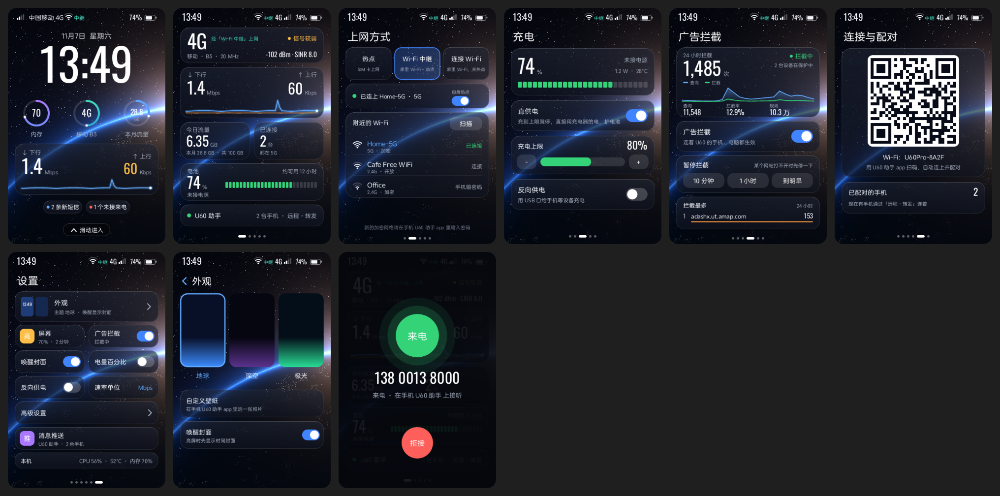

<div align="center">

# OpenU60

**把中兴 U60 Pro（MU5250）随身路由器变成一张中国手机卡的“桥”：短信、彩信、VoLTE 电话都由路由器接住，再转给你的手机。**

简体中文 · [English](README.en.md)

</div>

OpenU60 让中国手机卡常驻在中兴 U60 Pro 里。路由器上运行一个 agent（不刷机，装在中兴官方固件之上），负责收发这张卡的短信、彩信和 VoLTE 电话，修复中国卡漫游时常见的问题，还能让路由器接入家里的 Wi-Fi 上网，从而关掉昂贵的漫游数据。本仓库包含路由器端的全部代码：agent、替换原厂界面的触摸屏程序、macOS 一键安装工具“U60 刷机助手”、可以自己部署的远程访问中继和推送网关，以及一套命令行脚本。

> **请先读**：本项目与中兴通讯（ZTE）和任何运营商都无关。开启 ADB、修改开机脚本、关闭固件升级都有风险，可能让路由器停在开机画面、失去保修或丢失数据。动手前请先备份，并遵守运营商条款和当地法律法规。

## 目录

- [能做什么](#能做什么)
- [手机 App](#手机-app)
- [支持的硬件和固件](#支持的硬件和固件)
- [最简单：下载安装程序（Windows / Mac / Linux）](#最简单下载安装程序windows--mac--linux)
- [安装方法一：U60 刷机助手（推荐）](#安装方法一u60-刷机助手推荐)
- [安装方法二：命令行脚本](#安装方法二命令行脚本)
- [装好之后怎么用](#装好之后怎么用)
- [更新、卸载和救砖](#更新卸载和救砖)
- [从源码构建与测试](#从源码构建与测试)
- [目录结构](#目录结构)
- [文档](#文档)
- [致谢](#致谢)、[许可证](#许可证)、[免责声明](#免责声明)

## 能做什么

**路由器 agent（`zte-agent/`）**

- **短信**：收发、按会话整理；STD（海外版）固件的短信字段是加密的，agent 会自动处理。可选把短信转发到 Telegram、ntfy、Webhook、Discord、Slack 或另一个号码（上游功能）。
- **彩信（实验性）**：截获彩信通知，按 SIM 卡运营商拉起彩信 APN 下载图片和语音，也能发送。已在一家海外运营商网络上实测收发；中国三家运营商的参数取自 AOSP，尚未端到端验证。
- **VoLTE 电话**：来电提醒、拨号、挂断、DTMF；通话音频经路由器的 DSP 双向桥接到手机（G.711，8 kHz 窄带）。
- **中国卡漫游修复**：运营商配置关掉 IMS（VoLTE）注册时自动重新打开，并同步“短信走 IMS”的标志；运营商 DNS 不通时临时加上公共 DNS。
- **Wi-Fi 上行**：客户端模式下路由器像手机一样连上家里的 Wi-Fi 上网；中继模式下一个频段接上游，另一个频段继续开热点。这样可以关掉漫游数据省钱，短信和电话仍然走 SIM 卡。重启后自动恢复，卡住时自动重试。
- **流量套餐提醒**：月度额度、结算日、提醒阈值和每日上限。
- **通知与设备提醒**：推送按设备分别设置（来电、未接来电、短信、彩信），短信可以只通知通讯录联系人（验证码照常通知；路由器只收到联系人号码的哈希）。路由器还会主动提醒：电量低、没有信号、VoLTE 掉线、Wi-Fi 上行断开、温度过高、充电完成；路由器离线 5 分钟由推送网关代为通知。
- **广告拦截**：DNS 层拦截，带统计。
- **路由器管理（上游功能）**：信号与小区、频段/小区锁定、APN、Wi-Fi（含 Wi-Fi 7 开关）、防火墙、DNS/DoH、USB、电池与充电、计划任务、测速、AT 终端、Mihomo、Tailscale 等，提供 HTTP API 和网页管理面板。

**路由器触摸屏界面（`screen/`）**

一个自己写的屏幕程序，可以和原厂界面来回切换：锁屏时钟和实时网速、网络状态（信号、流量、已连接设备、电池、远程连接）、上网方式切换（SIM 热点 / Wi-Fi 中继 / Wi-Fi 客户端，可直接选附近的 Wi-Fi）、充电设置（充电上限、反向充电）、广告拦截开关和统计、连接手机用的 Wi-Fi 二维码、来电卡片，以及外观、亮度、锁屏等设置。



<sub>截图由屏幕程序自带的预览工具 `screen-preview` 用示例数据渲染，和真机显示一致（320×480，放大 2 倍）。</sub>

**U60 刷机助手（`desktop/U60Toolkit/`，macOS）**

图形界面，按顺序点四步：开启 USB 调试 → 备份 → 安装 → 用手机配对。也能卸载。

**远程访问（`tunnel/`、`relay/`，需自建）**

人不在路由器旁边时，手机通过端到端加密的 QUIC 隧道访问路由器：能打洞就直连，打不通就经中继转发，中继看不到内容。**本仓库不带任何默认服务器**，想用远程访问就自己部署一个中继（一台最便宜的 VPS 就够），见[远程访问与中继](docs/openu60/remote-access.md)。

## 手机 App

配套的 iPhone App **“U60 助手”不开源**，即将在 App Store 上架。上架后会在这里补上下载链接。

在 App 上架之前，你也可以完全不用 App：

- 用**路由器自己的触摸屏**切换上网方式、查看状态（见[触摸屏界面](#触摸屏界面)）；
- 用浏览器打开**网页管理面板**收发短信、拨打电话、管理路由器（见[网页管理面板](#网页管理面板)）；
- 直接调用 agent 的 **HTTP API**（见 [install.md 第 5 节](docs/openu60/install.md#5-从-mac-调用-agent-api)）。

来电推送、锁屏接听和手机上的通话音频需要手机 App。

## 支持的硬件和固件

| 项目 | 说明 |
|---|---|
| 路由器 | 中兴 U60 Pro（MU5250），硬件版本 `MU5250_HW1.0`（高通 SDX75，ZWRT/OpenWrt 23.05） |
| 已验证固件 | 海外版 `STD_PL_MU5250V1.0.0B02` |
| 其他固件 | 国行 B27/B31、港版等都**未验证**。短信加密、Wi-Fi 上行、通话音频都是按 STD 固件写的，别的固件上可能不工作；据社区反馈，B31 封堵了网页开启 ADB 的方法 |
| 电脑 | Windows 10/11、Mac 或 Linux 用下载好的安装程序；从源码构建需要 Mac（已在 Apple Silicon 上测试） |
| 数据线 | 能传数据的 USB-C 线 |
| 手机卡 | 需开通国际漫游；当地网络必须支持这张卡的 VoLTE 漫游，在已关闭 2G/3G 的国家尤其如此 |

## 最简单：下载安装程序（Windows / Mac / Linux）

不用装开发工具、不用编译。到 [Releases](https://github.com/Yakultt-t/openu60/releases) 找最新的「安装程序 / Installer」，下载对应系统的文件：

| 系统 | 文件 |
|---|---|
| Windows 10/11（64 位），想在外面也能用手机连路由器 | `OpenU60-Installer-Windows-x64-relay.exe`（带作者的中继，见下） |
| Windows 10/11（64 位），只在家里用或自建中继 | `OpenU60-Installer-Windows-x64.exe` |
| Mac（Apple 芯片） | `OpenU60-Installer-macOS-arm64` |
| Linux（x86-64） | `OpenU60-Installer-Linux-x64` |

它是一个文件，里面已经带着路由器要装的程序。双击运行（Mac/Linux 在终端里运行），按菜单数字操作：

1. **开启 USB 调试**：USB 线连好路由器，电脑连上路由器的 Wi-Fi，输入路由器后台密码。
2. **备份路由器配置**：几秒钟，保存在用户文件夹的 `OpenU60-备份` 里。
3. **完整备份**（可选）：把整块存储读出来（约 7.6 GB，半小时左右），每一块都校验。
4. **安装 / 更新**：装好后会显示一次 **SIM 随行密码**，抄下来，手机 App 配对时要用。
5. 查看状态、6. 卸载。

**Windows 第一次用要注意两件事：**

- 程序没有付费签名，Windows 可能弹出「Windows 已保护你的电脑」，点「更多信息」→「仍要运行」。
- 电脑里没有 adb 时，程序会问你要不要从 Google 官网下载，选是就行。Windows 默认**不认识**路由器的调试接口：第 1 步之后如果电脑认不出 ADB，程序会下载 Google 官方 USB 驱动、打开设备管理器，并告诉你每一步点哪里（在带黄色感叹号的设备上手动选「Android ADB Interface」）。这一步每台电脑只做一次。

**Mac 下载后**要先在终端里运行 `xattr -d com.apple.quarantine OpenU60-Installer-macOS-arm64 && chmod +x OpenU60-Installer-macOS-arm64`，再 `./OpenU60-Installer-macOS-arm64`。

也可以不进菜单，直接带参数运行：`enable-adb`、`status`、`backup [目录]`、`backup-full [目录]`、`install [--new-password]`、`uninstall`。源码在 [`desktop/openu60-installer/`](desktop/openu60-installer/)，`build_release.sh` 可以自己构建同样的文件。

**两个 Windows 版本的区别只有远程访问：**

- `-relay` 版默认用作者自己架设的中继：人在外面时手机也能连上路由器，不用自己买服务器。连接是端到端加密的，中继只转发看不懂的数据。这是作者个人免费提供的，不保证一直可用，也可能随时调整；之后在手机 App 里也可以改成自己的中继。
- 不带后缀的版本（以及 Mac、Linux 版）**不带任何默认中继和推送服务器**，和自己编译的一样：在家里局域网直接用；在外面远程访问要自己部署中继，见[远程访问与中继](docs/openu60/remote-access.md)。

两个版本都不带推送服务器。

## 安装方法一：U60 刷机助手（推荐）

目前还没有打包好的下载版本，需要在 Mac 上从源码构建一次。下面每一步都照着做就行。

### 第 1 步：安装工具（只做一次）

需要 Xcode（从 Mac App Store 安装，助手要求 macOS 15 及以上）和 [Homebrew](https://brew.sh)。打开“终端”，依次运行：

```bash
brew install android-platform-tools jq xcodegen zig pnpm
curl --proto '=https' --tlsv1.2 -sSf https://sh.rustup.rs | sh     # 安装 Rust，按提示选默认选项
source "$HOME/.cargo/env"
rustup target add aarch64-unknown-linux-musl
cargo install cargo-zigbuild
```

### 第 2 步：下载代码

```bash
git clone https://github.com/Yakultt-t/openu60.git
cd openu60
```

### 第 3 步：编译路由器上的程序

```bash
(cd web-admin && pnpm install && pnpm build)   # 网页管理面板；跳过的话，面板只显示一个占位页
scripts/u60/06_build_agent.sh                  # 编译 agent 和触摸屏程序
```

成功后会看到 `OK. Deploy: …`，产物在 `target/aarch64-unknown-linux-musl/release/`（`zte-agent` 和 `openu60-screen`）。第一次编译要几分钟。

### 第 4 步：构建并打开 U60 刷机助手

```bash
desktop/U60Toolkit/sync_payload.sh             # 把刚编译的程序和设备脚本放进助手
cd desktop/U60Toolkit
xcodegen generate
xcodebuild -project U60Toolkit.xcodeproj -scheme U60Toolkit -configuration Release \
  -derivedDataPath build build
open "build/Build/Products/Release/U60 刷机助手.app"
```

助手用的是 ad-hoc 签名，不需要 Apple 开发者账号。把它拷到别的 Mac 上时，第一次要在 Finder 里**右键 → 打开**，或者到“系统设置 → 隐私与安全性”里点“仍要打开”。

### 第 5 步：连接路由器

1. 路由器开机，装好 SIM 卡。
2. 用 USB-C 线把路由器接到 Mac。
3. Mac 连上路由器的 Wi-Fi（助手要访问路由器网页后台 `http://192.168.0.1`）。

### 第 6 步：在助手里按顺序点四步

1. **① 开启 USB 调试**：输入中兴网页后台的**管理员密码**（默认印在路由器标签上），点“开启”。约 10 秒后路由器的 USB 口进入调试模式（ADB）。这个密码只用这一次，不会保存。
2. **② 备份**：点“选择保存位置并备份…”。
   - “配置备份”只有几 MB、几秒钟，包含设备信息、分区表和全部配置。
   - “完整备份”会读出整块存储（约 7.6 GB，15 分钟左右），每一块都校验。期间不要拔线，不要合上 Mac。
   - 备份里有 IMEI、序列号和你的配置，**不要公开**。
3. **③ 安装 U60 Pro 软件**：
   - 助手会关闭中兴的固件升级和云服务，关闭中兴自带的每周定时重启，把 agent、触摸屏程序、守护进程、Wi-Fi 上行脚本和开机钩子装到路由器上。
   - 会生成一个 **U60 助手密码**（也就是 agent 密码，8–64 位，只能用字母、数字和 `-_.`）。安装完成后它**只显示一次**，请复制保存。手机 App、网页管理面板和 HTTP API 都用它登录。
   - 以后更新时，可以勾选“保留现在的 U60 助手密码”，已配对的手机不用重新登录。
4. **④ 用手机配对**：
   1. 在 iPhone 上安装 U60 助手 App 并打开（App 即将在 App Store 上架，见[手机 App](#手机-app)）。
   2. 按引导连上路由器的 Wi-Fi（可以扫路由器屏幕上的 Wi-Fi 二维码）。
   3. 输入 U60 助手密码，配对完成后在哪里都能用（在外面使用需要[自建中继](docs/openu60/remote-access.md)）。

   暂时没有 App 的话，跳过这一步，直接看[装好之后怎么用](#装好之后怎么用)。

安装脚本也可以不开图形界面，直接在终端里运行，见 [install.md](docs/openu60/install.md#2-路线-au60-刷机助手mac-app)。

## 安装方法二：命令行脚本

适合想逐步控制的人。先完成上面的第 1–3 步（装工具、下载代码、编译），并把路由器用 USB 接到 Mac、Mac 连上路由器 Wi-Fi，然后在仓库根目录依次运行：

```bash
scripts/u60/01_enable_adb.sh                          # 开启 USB 调试：交互输入后台管理员密码（不回显、不保存）
scripts/u60/02_backup.sh "$HOME/u60/backup-$(date +%Y%m%d)"   # 整盘备份（约 7.6 GB）
scripts/u60/03_disable_cloud.sh                       # 关闭固件升级和中兴云
scripts/u60/04_deploy_agent.sh target/aarch64-unknown-linux-musl/release/zte-agent   # 部署 agent
```

> **警告：03 之后必须马上执行 04，中间不要重启路由器。** 03 停用的两个服务在厂商的开机同步列表里，04 的第一步才会把它们从列表里注释掉；在这之前重启，开机会一直卡在 logo。详见 [install.md](docs/openu60/install.md#03-关闭固件升级和中兴云)。

- 04 第一次运行时会生成一个 24 位随机的 agent 密码，保存在 Mac 上的 `~/u60/agent-credentials.txt`（权限 600），脚本不会把它打印出来。查看：`sed -n 's/^ZTE_AGENT_PASSWORD=//p' ~/u60/agent-credentials.txt`。
- 04 只部署 agent。想要触摸屏界面，再执行：

```bash
adb shell 'mkdir -p /data/openu60/screen'
adb push target/aarch64-unknown-linux-musl/release/openu60-screen /data/openu60/screen/openu60-screen
adb shell 'chmod 755 /data/openu60/screen/openu60-screen'
```

agent 每分钟检查一次，看到这个文件就会把屏幕程序拉起来，不用重启。

每个脚本做了什么，见 [install.md](docs/openu60/install.md#3-路线-b命令行脚本)。

## 装好之后怎么用

### 触摸屏界面

- **打开**：路由器开机满 1 分钟后，**快速连按三下电源键**（每两下之间不超过 0.6 秒），屏幕从中兴原厂界面切换到 OpenU60 界面。
- **回到原厂界面**：再快速连按三下电源键，或者在“设置”里点“回到原厂界面”。
- **单按一下电源键**：熄屏或点亮。**长按约 2 秒**：弹出重启/关机菜单。
- **主要页面**：锁屏（时钟、实时网速，滑动进入）→ 网络、上网方式、充电、广告拦截、连接手机（Wi-Fi 二维码）、设置。来电时会弹出来电卡片，在屏幕上只能拒接，接听要用手机。
- 屏幕程序如果 2 分钟内崩溃两次，会自动留在原厂界面，不影响路由器正常使用。想彻底关掉它：`adb shell 'touch /data/openu60/screen/disabled'`（删掉这个文件即可恢复）。

### 网页管理面板

1. 电脑或手机连上路由器的 Wi-Fi。
2. 浏览器打开 **`http://192.168.0.1:9090`**。
3. 用 U60 助手密码（agent 密码）登录。

面板里有概览、信号、短信（收发、转发规则）、电话（拨号、接听、挂断、DTMF）、移动网络、频段小区、Wi-Fi、路由设置、SIM 卡、设备管理、工具箱、Mihomo、Tailscale 等页面。路由器处在 Wi-Fi 客户端/中继模式时，家庭网里的设备也可以用路由器在家庭网里的 IP 加 `:9090` 访问。

> 不要把 9090 端口直接暴露到公网。在外面访问请用[自建中继](docs/openu60/remote-access.md)或 Tailscale。

### 忘了 agent 密码

密码只存在路由器上的启动脚本里。路由器连着 USB 时可以查回来：

```bash
adb shell "sed -n \"s/^export ZTE_AGENT_PASSWORD='\(.*\)'$/\1/p\" /data/local/tmp/start_zte_agent.sh"
```

用助手重新安装、不勾选“保留现在的密码”，就会换一个新密码。

### 让路由器连家里的 Wi-Fi

在触摸屏的“上网方式”页面选择模式，再从附近的网络里选你家的 Wi-Fi 并输入密码；也可以在网页面板或 App 里操作。

| 模式 | 说明 |
|---|---|
| SIM 热点（默认） | 走 SIM 卡的数据，2.4G 和 5G 热点都开着 |
| Wi-Fi 中继 | 一个频段连家里的 Wi-Fi，另一个频段继续开热点 |
| Wi-Fi 客户端 | 只连家里的 Wi-Fi，路由器自己的热点关闭，手机通过家里的网络访问路由器 |

连上之后就可以在网页面板的“移动网络”里关掉蜂窝数据，省漫游费；短信和电话仍然走 SIM 卡（关数据是否影响 VoLTE 取决于运营商，建议实测）。路由器重启后会自动重新连上；为了防止连不上时手机再也找不到路由器，开机恢复时另一个频段的热点会保持开着。细节见[路由器运行时](docs/openu60/router-runtime.md#wi-fi-上行)。

### 在外面远程访问

1. **买一台云服务器**（1 核 1 GB 就够，Ubuntu/Debian 等 Linux，x86_64 或 ARM 都行），用 root 运行这一条命令：

   ```bash
   curl -fsSL https://raw.githubusercontent.com/Yakultt-t/openu60/main/scripts/relay/install.sh | sudo bash
   ```

   脚本会装好转发服务 `openu60-relay`、设成开机自启、打开 UDP 443 端口，并在最后显示要填的地址。如果云服务商有自己的防火墙（安全组），记得在控制台里也放行 **UDP 443**。卸载时在命令后加 `-s -- --uninstall`；其他选项（换端口、手动安装）见[远程访问与中继](docs/openu60/remote-access.md#自建中继)。
2. **在 App 里添加这台服务器**：设置 → 设备与配对 → 转发服务器 → “+”，填上一步显示的地址，点“添加并立即使用”。路由器会先试连新服务器，连不上就保持原样，不会失联。不用 App 的话，可以调接口：`PUT /api/tunnel/config {"relays": ["你的地址:443"]}`。
3. 手机在局域网里登录一次完成配对，之后在外面也能连上。

## 更新、卸载和救砖

**更新**：拉取新代码，重新执行[第 3 步](#第-3-步编译路由器上的程序)和[第 4 步](#第-4-步构建并打开-u60-刷机助手)，在助手里再点一次“③ 安装”，勾选“保留现在的 U60 助手密码”。命令行用户重新运行 `06_build_agent.sh` 和 `04_deploy_agent.sh` 即可，密码不变。

**卸载**：助手里的“卸载…”，或 `desktop/U60Toolkit/Resources/payload/u60.sh uninstall`。会停止并删除 agent 和屏幕程序、去掉开机钩子，Wi-Fi 切回普通热点模式；`/data/openu60` 里的数据保留，固件升级仍保持关闭。想恢复中兴固件升级，见 [install.md](docs/openu60/install.md#6-卸载与还原)。

**开机卡在 logo**：最常见的原因是开机同步列表里的厂商进程被停用了（见上面 03 的警告）。只要 `adb devices` 还能看到路由器，就能修复，步骤见 [install.md](docs/openu60/install.md#6-卸载与还原) 和[路由器运行时](docs/openu60/router-runtime.md#关闭的厂商服务)。

**不要升级中兴固件**：一次在线升级（FOTA）就可能清掉 agent 和 ADB，新固件还可能封堵开启 ADB 的方法。安装时已经关闭了自动升级。

## 从源码构建与测试

| 组件 | 命令 |
|---|---|
| 网页管理面板 | `cd web-admin && pnpm install && pnpm build`（输出到 `zte-agent/web-dist/`，编译 agent 时嵌入） |
| agent + 触摸屏程序 | `scripts/u60/06_build_agent.sh`（`cargo zigbuild`，目标 `aarch64-unknown-linux-musl`） |
| U60 刷机助手 | `desktop/U60Toolkit/sync_payload.sh` 后 `xcodegen generate` + `xcodebuild`（见第 4 步） |
| 中继 | `cargo build --release -p openu60-relay`，或交叉编译 `cargo zigbuild --release --target x86_64-unknown-linux-musl -p openu60-relay` |
| 推送网关（可选） | `cargo build --release -p openu60-pushgw`，配置见 `pushgw/src/main.rs` 开头的说明 |
| 测试 | `cargo test -p openu60-tunnel --features mdns`（隧道的进程内端到端测试） |

**自己的默认中继和推送网关**：公开版本不带任何默认服务器。想让自己编译的 agent 默认就用你的中继和推送网关，在 `~/u60/config.env`（脚本会自动读取，不要提交到仓库）里写：

```bash
export OPENU60_DEFAULT_RELAYS=relay.example.com:443            # 多个用逗号分隔
export OPENU60_PUSH_GATEWAY=https://push.example.com/v1/push
```

然后重新执行 `06_build_agent.sh`。运行时也可以用 `PUT /api/tunnel/config` 改中继，用环境变量 `ZTE_AGENT_PUSH_GATEWAY` 改推送网关。

私有文件（agent 密码、构建日志、`config.env`）都放在仓库外的 `${U60_HOME:-~/u60}`。

## 目录结构

| 目录 | 内容 |
|---|---|
| `zte-agent/` | 路由器上的 Rust agent：HTTP API（:9090）、短信/彩信、推送、通话监控与音频桥（UDP :9091）、IMS/DNS 守护、Wi-Fi 上行、隧道端 |
| `screen/` | 路由器触摸屏程序 `openu60-screen`（DRM，320×480） |
| `desktop/U60Toolkit/` | macOS 安装工具“U60 刷机助手”，安装逻辑在 `Resources/payload/u60.sh` |
| `tunnel/` | 隧道共享库：身份与配对、QUIC、打洞、中继协议、语音通道 |
| `relay/` | 中继服务 `openu60-relay`（UDP，自建） |
| `pushgw/` | 推送网关 `openu60-pushgw`（自建，持有 APNs 密钥，路由器用自己的隧道身份签名请求） |
| `scripts/u60/` | 命令行脚本 01–04、06–11；`device/` 是装到路由器上的脚本，`tools/` 是分析工具 |
| `scripts/mms/` | 彩信 PDU 编解码小工具（研究用） |
| `web-admin/` | 网页管理面板（上游，编译时嵌入 agent） |
| `web/` | 上游项目的网站 |
| `lpac-qrtr-build/` | lpac（eSIM 管理）QRTR 后端的交叉编译配方，研究用 |
| `docs/` | 文档：`docs/openu60/` 是本项目的使用文档，`docs/design/`、`docs/research/` 是设计与研究记录 |

## 文档

| 文档 | 内容 |
|---|---|
| [安装](docs/openu60/install.md) | 两条安装路线的每一步、每个脚本做了什么、从 Mac 调用 API、卸载与还原 |
| [架构](docs/openu60/architecture.md) | 短信、彩信、通话、推送、远程访问的数据流 |
| [中国卡漫游指南](docs/openu60/china-sim.md) | VoLTE/IMS 注册修复、彩信 APN、国际短信拦截、iMessage |
| [通话音频](docs/openu60/call-audio.md) | 音频链路、抖动缓冲、已知问题、测试脚本 |
| [路由器运行时](docs/openu60/router-runtime.md) | 守护进程、开机钩子、各类守护、重启恢复、Wi-Fi 上行、Wi-Fi 7 |
| [远程访问与中继](docs/openu60/remote-access.md) | 隧道设计、自建中继、安全与隐私 |
| [eSIM 与屏幕](docs/openu60/esim-and-screen.md) | 海外版没有内置 eSIM；可插拔 eUICC + lpac；触摸屏程序 |
| [常见问题](docs/openu60/faq.md) | 通话、短信、推送、连接、路由器的常见问题 |

## 致谢

- [jesther-ai/open-u60-pro](https://github.com/jesther-ai/open-u60-pro)：原始项目（agent、web 面板、Mihomo、Tailscale 等），以及 [game-loader/open-u60-pro](https://github.com/game-loader/open-u60-pro) 分支。本项目基于它们开发，原 README 见 [docs/upstream-README.md](docs/upstream-README.md)。
- [amenekowo/mu5250_tweaking](https://github.com/amenekowo/mu5250_tweaking)：通过网页 ubus 开启 ADB 的方法，以及固件语音/音频栈的早期研究（GPL-3.0）。
- [acloudpeng/U60Pro-OpenUI](https://github.com/acloudpeng/U60Pro-OpenUI)：在路由器上管理 eSIM profile 的做法和 DevUI 屏幕方案。
- [SadykovIV/ZTE_U60Pro](https://github.com/SadykovIV/ZTE_U60Pro)、[faying/luya-z-manager](https://github.com/faying/luya-z-manager) 等社区研究。
- [estkme-group/lpac](https://github.com/estkme-group/lpac)（AGPL-3.0），[quinn](https://github.com/quinn-rs/quinn)、[rustls](https://github.com/rustls/rustls)、[ring](https://github.com/briansmith/ring) 等开源库；彩信参数来自 AOSP 的 `apns-full-conf.xml`，彩信流程参考了 mmsd-tng、oFono 的公开资料（只参考流程，没有使用其代码）。

## 许可证

MIT，见 [LICENSE](LICENSE)，其中保留了上游项目的原始版权声明；OpenU60 的修改同样以 MIT 发布。例外：`scripts/u60/01_enable_adb.sh` 移植自 amenekowo/mu5250_tweaking，按 GPL-3.0 发布；`lpac-qrtr-build/patches/` 修改的是 lpac 的源码，按 lpac 的 AGPL-3.0-only 发布；引用的第三方项目各自沿用原许可证。

## 免责声明

- 本项目与中兴通讯（ZTE）及各运营商无关，只供你在自己拥有的设备上使用。
- 刷机、开启 ADB、修改开机脚本、关闭固件升级都有风险，可能导致无法开机、失去保修或数据丢失；后果自负。动手前先做备份。
- 请遵守运营商条款和当地法律法规，包括 SIM 卡实名、漫游使用条款，以及通话录音须征得对方同意等规定。
- 自建中继或推送网关时，你就是服务的运营者：中继看不到通信内容，但能看到双方的公网 IP、连接时间和流量大小；推送网关持有 APNs 密钥，请妥善保管，不要随设备分发。
